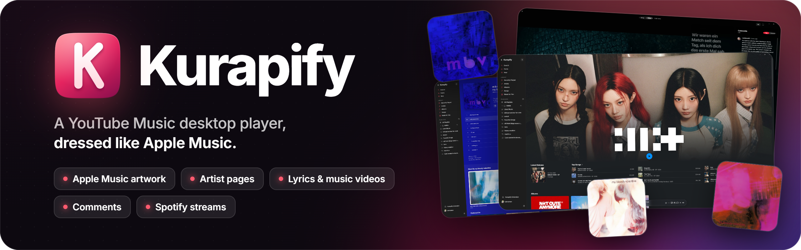
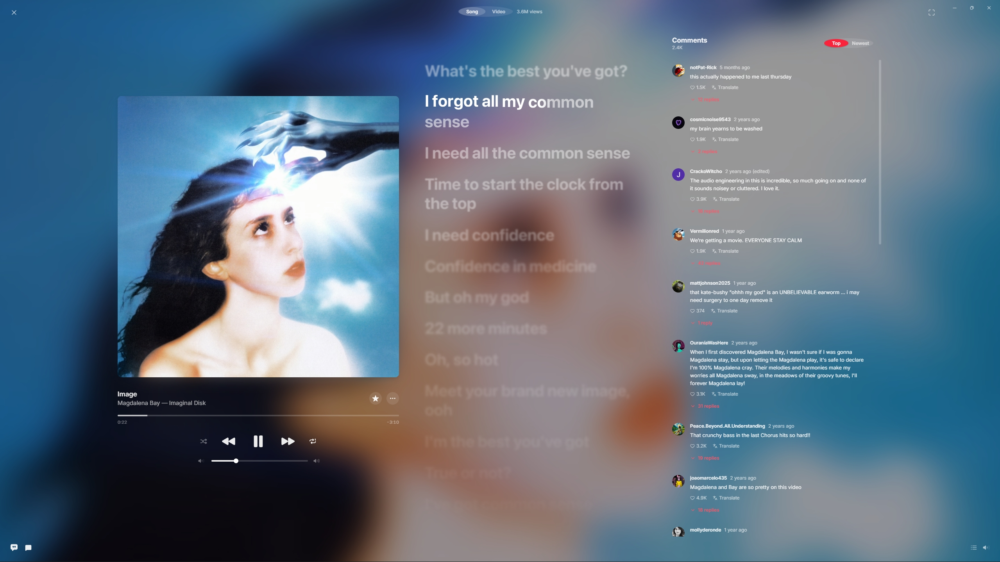
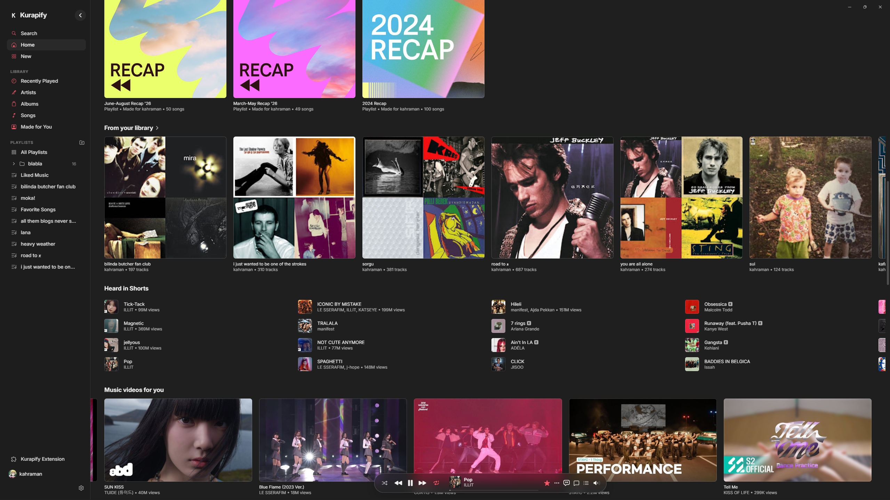
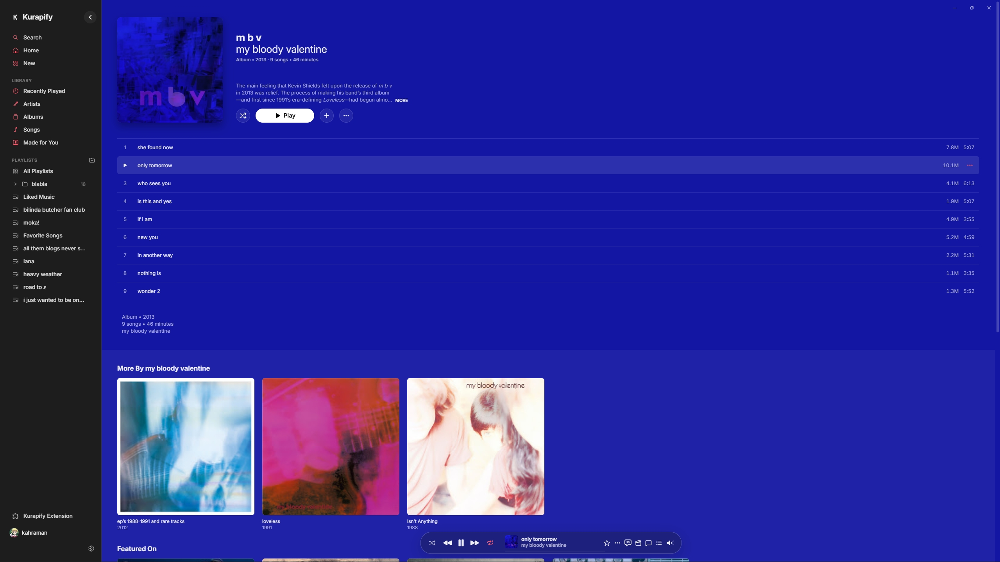
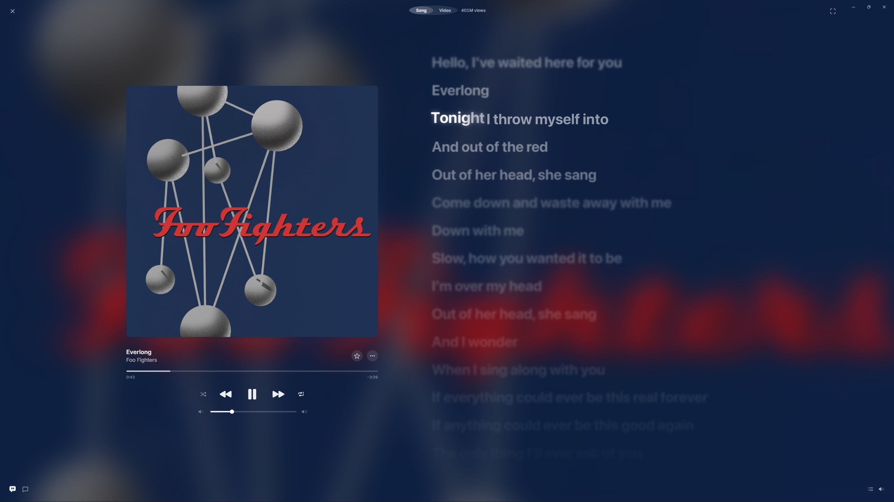
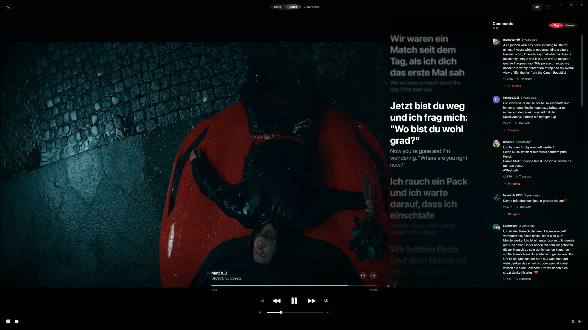
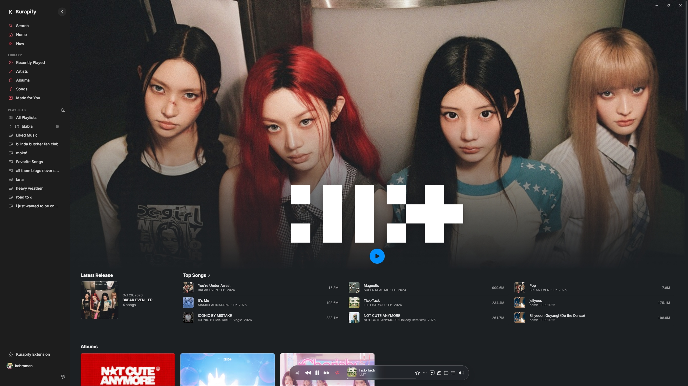
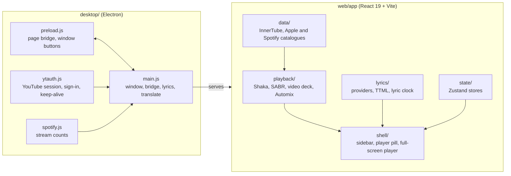

<div align="center">



<br/>

**Apple Music's artwork and artist pages, music videos with lyrics and comments, and Spotify stream counts: your YouTube Music, in one fast Windows window.**

<br/>

[](LICENSE)
[](https://www.electronjs.org/)
[](https://react.dev/)
[](https://www.typescriptlang.org/)
[](#install-and-run)

[Highlights](#highlights) · [Screenshots](#screenshots) · [And the rest](#and-the-rest) · [Download](#download) · [Build](#build-it-yourself) · [Contributing](#contributing) · [License](#license)

<br/>



</div>

> [!IMPORTANT]
> Kurapify is an independent project. It is not affiliated with, endorsed by, or connected to YouTube, Google, Apple or Spotify. See the [disclaimer](#disclaimer).

---

## Highlights

<table>
<tr>
<td width="33%" valign="top">

#### Apple Music artwork
Covers, Apple's **moving artwork**, editorial notes and hand-picked album colours, wherever Apple has them. Pages are tinted to match, and the full-screen player blurs the cover behind everything.

</td>
<td width="33%" valign="top">

#### Artist pages
Laid out the way Apple lays them: a moving header, the latest release, top songs with their album and date, and shelves of *more by*, *featured on* and *you might also like*.

</td>
<td width="33%" valign="top">

#### Lyrics and music videos
Word-by-word **synced lyrics** with translation and romanization, and a **Song / Video** switch that finds the music video itself, up to **4K**, with the lyrics laid over it.

</td>
</tr>
<tr>
<td width="33%" valign="top">

#### Comments
Read, sort and reply-browse comments with one-tap translation, beside the song or over the video. Over a video, lyrics and comments each tighten and sit on the side you choose.

</td>
<td width="33%" valign="top">

#### Spotify streams
A **stream count** next to every song, read from Spotify's public catalogue, so you see at a glance what is big: on albums, playlists and artist pages.

</td>
<td width="33%" valign="top">

#### Your music
Sign in for your YouTube Music library, playlists and history, or add **your own files and folders** (MP3, FLAC, M4A, WAV, Opus) and play them in the same player.

</td>
</tr>
</table>

## Screenshots

| | |
|:--:|:--:|
|  |  |
| **Home** | **Album** |
|  |  |
| **Lyrics and translation** | **Video, lyrics and comments** |

<p align="center"><br/><b>Artist page</b></p>

### And the rest

- **Highest-bitrate audio**, including YouTube Music Premium's 256 kbps stream when you are signed in with Premium. Pick a quality in Settings.
- **Crossfade and Automix**: gapless playback, or DJ-style blends with beat matching and tempo stretching.
- **Playlists** you can create, edit, reorder and file into folders; **Save to Library**, **Pin to Listen Again**, **Show Credits**, **Start Mix**, and **Not Interested** sent to YouTube Music itself.
- **Now Playing view**: a column on the right that opens from the player bar, with the big cover, the artist, the credits and what is next.
- **Search history**, **Stats for Nerds**, and a window that goes quiet on the CPU when minimised.

## Download

The quickest way: get the latest build from [**Releases**](https://github.com/shii-zuku/kurapify/releases/latest).

- **`Kurapify-Setup-x.y.z.exe`**: the installer (per user, no admin needed; Start menu and desktop shortcuts).
- **`Kurapify-x.y.z-win-x64.zip`**: unzip anywhere and run `Kurapify.exe`, nothing is installed.

Windows 10 or 11, 64-bit. The builds are not code-signed, so Windows SmartScreen may say *Windows protected your PC*: choose **More info**, then **Run anyway**.

## Build it yourself


Kurapify runs on **Windows 10 and 11** and needs **Node.js 22 or newer** (pnpm comes through corepack).

```bash
git clone https://github.com/shii-zuku/kurapify.git && cd kurapify
corepack pnpm --dir web install
VITE_PARTY_SERVER_URL=https://party.invalid corepack pnpm --dir web/app build   # PowerShell: set $env:VITE_PARTY_SERVER_URL first

cd desktop
npm install
node sync-web.mjs
npx electron .            # run it in a window
npx electron-builder --win dir   # or package it: release/win-unpacked/Kurapify.exe
```

The Listen Together server is optional; see Configuration below.

<details>
<summary><b>Signing in</b></summary>

Google refuses sign-in inside an embedded window, so **Sign In opens your own browser** in a throwaway profile (Chrome, Edge, Brave and other Chromium browsers work, your default one is used when it is Chromium). You sign in there, Kurapify takes the session and the browser window closes. Your open browser and its tabs are left alone.

- The session belongs to Kurapify alone, so nothing else rotates it behind its back. A copy of a browser's live session does not last: the browser and the app keep swapping its timestamp cookies and one ends up with retired ones.
- Kurapify keeps the session fresh in the background.
- If that does not work, you can import an exported cookie file (Ctrl+Shift+I) or, with the browser closed, take its session directly. Ctrl+Shift+O signs out.
- Signed out, you can still search and browse, but YouTube may ask for a sign-in to play some tracks.

Your cookies stay in the app's own data folder on your machine and are only ever sent to Google.

</details>

<details>
<summary><b>How it works</b></summary>



- **Playback** goes through YouTube's own player API: [`youtubei.js`](https://github.com/LuanRT/YouTube.js) for the InnerTube client, `googlevideo` for SABR streaming and [Shaka Player](https://github.com/shaka-project/shaka-player) on the browser's Media Source Extensions. A second, muted Shaka player draws music videos over the audio.
- **Lyrics** are drawn by [`am-lyrics`](https://www.npmjs.com/package/@uimaxbai/am-lyrics) from several providers, with Google for translation and romanization.
- **Automix** is a port of [AutoMix](https://github.com/heydavidf/automix)'s DJ engine, analysis in a worker with essentia.js.
- **Artwork and editorial text** come from Apple Music's public web catalogue; **stream counts** from Spotify's.
- **The renderer** is a regular web app, so `web/app` also runs in a browser with the companion extension (`web/extension`).

Longer notes on each part are in [`web/docs`](web/docs): the YouTube sign-in, queue and player, lyrics, Automix, Spotify, and the Apple Music design measurements.

</details>

<details>
<summary><b>Configuration and development</b></summary>

Build-time options are Vite environment variables (`web/app/.env.example`):

| Variable | Purpose | Default |
|---|---|---|
| `VITE_PARTY_SERVER_URL` | Listen Together server (`https://host`). The production build refuses to run without a value; use `https://party.invalid` to leave the feature off | none |
| `VITE_EXTENSION_ID_CHROMIUM` | Id of the companion extension, for the web build | the pinned development id |
| `VITE_ANDROID_APP_URL` | Where the "Get the app" banner of a phone browser points | the releases page |

The desktop app takes `KURAPIFY_PORT` (the local port it serves the player on, default `47183`) and `KURAPIFY_TRACE=1` (logs the YouTube session's requests).

```bash
corepack pnpm --dir web install
corepack pnpm --dir web -r typecheck        # types
corepack pnpm --dir web/app exec vitest run # tests
corepack pnpm --dir web/app dev             # the player in a browser, http://localhost:5173
```

The tests parse **real captured responses** (`web/fixtures`) rather than hand-written ones; `web/scripts/capture-fixtures.mjs` refreshes them.

</details>

## Contributing

Issues and pull requests are welcome. Read [CONTRIBUTING.md](CONTRIBUTING.md) first; it is short.

<details>
<summary><b>Disclaimer</b></summary>

Kurapify is a client for services it does not run. It is **not affiliated with, endorsed by, or connected to YouTube, Google, Apple Inc. or Spotify AB**; all names and trademarks belong to their owners. It plays music through YouTube's player interfaces and reads public catalogue data from Apple Music and Spotify; those services' terms apply to how you use it, and they can change or block these interfaces at any time. It does not download or save music, and it ships no music. **Use it at your own discretion and risk.**

</details>

## License

Kurapify is free software under the **GNU General Public License v3.0**, see [LICENSE](LICENSE). It builds on other open-source projects and keeps their licenses and credits: see [NOTICE.md](NOTICE.md).
